  

  
  
  

  

---

### `> focus`

<table>
  <tr>
    <td width="33%" valign="top">
      <b>☁️ Cloud Security</b> 
      Hardening, gestión de identidades y accesos y postura de seguridad en la nube.
    </td>
    <td width="33%" valign="top">
      <b>📡 SIEM</b> 
      Gestión de SIEM, ingesta y correlación de logs, detección y monitorización.
    </td>
    <td width="33%" valign="top">
      <b>🌐 Web Dev</b> 
      Desarrollo web con foco en código limpio y seguro.
    </td>
  </tr>
</table>

### `> stack`

  
  
  
  
  
  
  <!-- Añade tus herramientas copiando una línea: cambia el nombre y el logo (slug de simpleicons.org).
       Ejemplos: logo=amazonwebservices, logo=microsoftazure, logo=googlecloud, logo=splunk, logo=wazuh, logo=python, logo=docker -->

### `> projects`

<!-- Añade filas a medida que publiques repos -->
| repo | descripción |
| --- | --- |
| _próximamente_ | |

---

  <code>contacto</code> → abre un issue en cualquiera de mis repos

