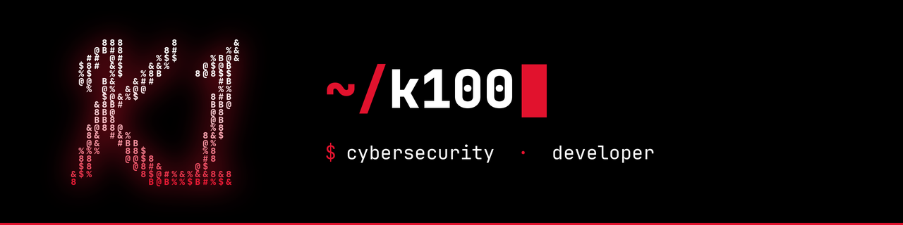

  

  
  

### Sobre mí

Trabajo en **ciberseguridad** y **desarrollo**: seguridad en la nube, detección y monitorización con SIEM, y aplicaciones web construidas con la seguridad como base.

### Stack

  

<!-- Proyectos: añade una sección cuando publiques repos, por ejemplo:
### Proyectos
| Repo | Descripción |
| --- | --- |
| [nombre](https://github.com/kln-100/nombre) | Qué hace en una línea |
-->

---

  Contacto: abre un issue en cualquiera de mis repos

