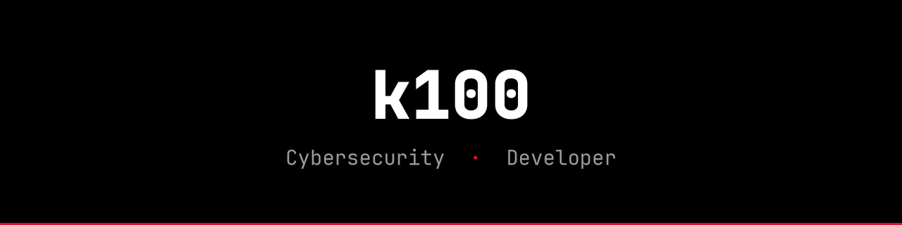

  

  
  

### About me

Student focused on **cybersecurity** and **development**: cloud security, detection and monitoring with SIEM, and building web applications with security in mind.

### Stack

  
  
  
  
  

<!-- Projects: add a section once repos are public, e.g.
### Projects
| Repo | Description |
| --- | --- |
| [name](https://github.com/kln-100/name) | What it does in one line |
-->
